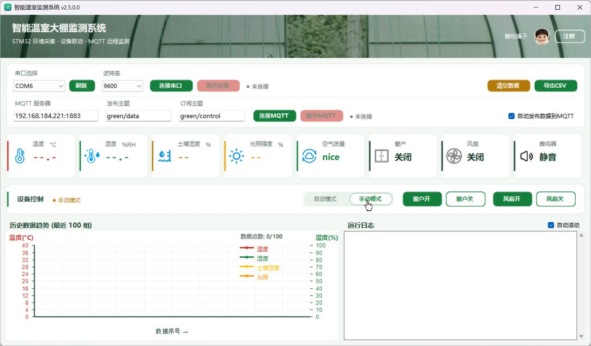

# 智能温室大棚监测系统 · PC 上位机

STM32 智能温室物联网系统的**PC 端**：通过串口接收下位机环境数据帧，解析后实时展示并经 MQTT 发布上云，
同时订阅控制主题把远程指令透传到串口，是"手机 → MQTT → 串口 → 单片机"远程控制链路的中枢。

> 系统总览、固件、EMQX、小程序请见仓库根目录 README。

## 界面截图

| 登录页 | 主界面（手动模式） |
| --- | --- |
|  |  |

## 界面设计规范（v2.5 改版）

视觉语言为"**温室绿 + 暖木 + 奶油白**"浅色系（Organic Biophilic，配色取自 ui-ux-pro-max
设计系统推荐：主色 `#15803D` 土绿 / 点缀 `#A16207` 丰收金 / 底色 `#F0FDF4` 薄荷白）：

- **登录窗**：整窗温室实拍背景 + 深绿纱罩 + 居中圆角白卡（品牌图标 / 中英文标题 /
  圆角输入框聚焦描边 / 绿色登录钮），左下角产品落款
- **主窗体**：顶部温室实拍横幅（渐变纱罩 + 白字产品名 + 用户区）；全按钮统一为
  `RoundedButton`（圆角 8px、高度 32px、悬停/按压态、禁用降透明），模式切换为
  `SegmentedControl` 分段控件，天窗/风扇"开=实心 / 关=空心"，坐标按 8px 网格在
  `ApplyResponsiveLayout` 统一计算
- **设计令牌单一真源**：`AppTheme.cs` 集中定义色板/圆角/间距/字体，控件不写魔法数

## 功能

- **串口解析**：正则匹配 `Temp:XXC` / `Humi:XX%RH` / `Soil:XX%(raw=XX)` / `Light:XX%` / `Servo` / `Motor` / `Mode` / `Air` / `Warning`（与固件 V1.2 输出协议逐字段对应，单字段异常不再丢弃整帧）
- **实时展示**：GDI+ 自绘温度/湿度/土壤湿度/光照四曲线、六组状态图标（双状态随报警切换）、阈值报警日志
- **MQTT 双向**：发布 `green/data`（QoS 1，JSON 含 `soilMoisture` / `lightPercent` / `mode` 字段）；订阅 `green/control` 并原文转发串口
- **设备控制**：自动/手动模式切换、天窗舵机、风扇电机按钮（对应 `mode-*` / `DUOJ-*` / `MOTOR-*` 指令）
- **登录鉴权**：启动先弹登录窗（默认 `admin` / `admin`），主界面顶栏「注销」可返回登录页重新登录
- **数据导出**：CSV（含时间戳与报警类型）

## 统一报警阈值（三端一致）

温度 > 26 °C / 空气湿度 > 85 %RH / 土壤湿度 > 40 % / 空气 bad——报警展示直接依据固件同一组数值与 `Warning` 标志。

## 编译与运行

Visual Studio 2019+ 打开 `DHT11.csproj`（NuGet 自动还原 MQTTnet 4.3.7，或使用 `packages/` 目录），编译生成 `智能温室.exe`：

0. 启动后先登录：默认账号 `admin`、密码 `admin`（点「退出」或关闭登录窗则直接结束程序）
1. 选择串口、9600 波特率 → 连接串口
2. MQTT 服务器填 EMQX 主机 `IP:1883` → 连接（发布 `green/data` / 订阅 `green/control`）
3. 勾选"自动发布数据到 MQTT"即可持续发布
4. 顶栏「注销」会回到登录页，可换账号重新登录（当前仅 `admin`）

> 💡 实物不在身边时，可用 [`05-Testing-Tool`](../05-Testing-Tool) 链路调试工具模拟固件帧驱动本上位机完成全链路联调。

详细操作说明见 [MQTT功能使用说明.md](./MQTT功能使用说明.md)。

## 关键源码

| 文件 | 说明 |
| --- | --- |
| `Form1.cs` | 全部 UI 与业务逻辑（串口/解析/图表/MQTT），约 2510 行 |
| `LoginForm.cs` | 登录窗口（纯代码构建，默认 `admin` / `admin`） |
| `Program.cs` | 入口：登录 → 主界面 → 注销可回到登录 |
| `AppTheme.cs` | 设计令牌单一真源(色板/圆角/间距/字体) |
| `RoundedButton.cs` | 统一圆角按钮 + 模式分段控件(自绘控件) |
| `MQTT功能使用说明.md` | MQTT 配置与三端联调文档（v2.3） |
