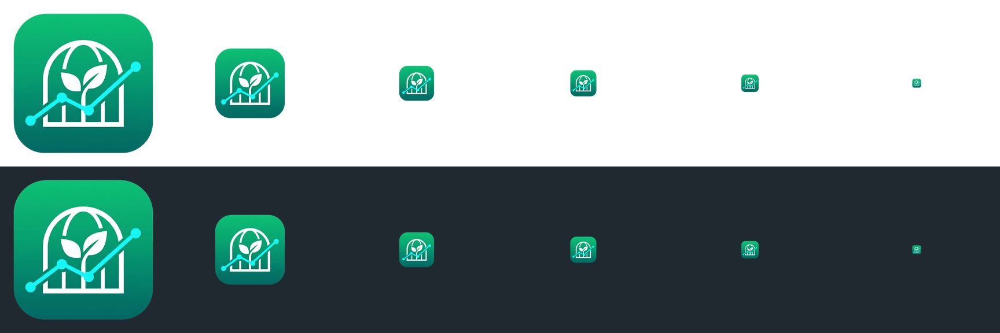

# 应用图标替换改造报告

> 目标：把 `智能温室.exe`（C# WinForms / .NET Framework 4.7.2）的**全部**图标——资源管理器里的 exe 文件图标、窗体标题栏小图标、任务栏图标、Alt+Tab 缩略图——统一换成新设计的 `APP-ICON.jpg`。
> 状态：**已完成并通过编译验证**，等程序关闭后重新编译即可生效。

---

## 0. 一句话结论

原来有三个各自独立的图标来源会互相打架（exe 文件图标 / 窗体标题栏 / 任务栏），本次把它们收敛成**同一个 `.ico` 文件**，并加了四级降级链，任何一级丢失都不会退回 WinForms 默认的蓝白小方块。

---

## 1. 改动清单

| 文件 | 类型 | 说明 |
|---|---|---|
| `convert_icon.py` | **新建** 424 行 | JPG → 透明多尺寸 ICO 转换脚本 |
| `AppIcon.cs` | **新建** 258 行 | 统一图标解析器，四级降级 + 按 DPI 精修图标帧 |
| `DHT11.csproj` | 修改 | `ApplicationIcon` + 内嵌资源 + ICON 目录内容项 |
| `LoginForm.cs` | 修改 | 构造函数调用 `AppIcon.Apply(this)`，修正过时注释 |
| `Form1.cs` | 修改 | 构造函数调用 `AppIcon.Apply(this)` |
| `ICON/app_icon.ico` | 重新生成 | 6 帧 32bpp，370 KB |
| `ICON/app_icon_old.ico` | 新增备份 | 旧图标（89 KB 单帧），方便回滚 |
| `ICON/app_icon_preview.png` | 新增 | 浅底/深底双行尺寸阶梯预览图 |

**没有改动**：`ICON/` 下 16 个功能状态 PNG 一张没动，界面配色、逻辑、协议全部原样。

---

## 2. 任务一：`convert_icon.py`（JPG → 透明 ICO）

### 2.1 为什么不能直接改后缀

源图 `APP-ICON.jpg` 是 2048×2048 的 **JPG**：没有 Alpha 通道，外圈是纯白背景，主体是翡翠绿圆角方形（squircle）。直接改名成 `.ico` 会得到一张**白底方块**图，扔到 Windows 任务栏的浅色主题上就是一块刺眼的白斑。

### 2.2 四步处理流程

```
[1/5] 读取源图          → 2048×2048 RGB
[2/5] 识别背景并抠主体   → 取最外一圈像素中位数当背景色，从四边「灌水」求外部区域
[3/5] 重建软 Alpha      → 只在内边界环带内求解覆盖率，边缘颜色用主体本色外扩填充
[4/5] 生成尺寸阶梯      → 预乘 Alpha 后 LANCZOS 缩放到 256/128/64/48/32/16
[5/5] 打包 ICO          → BITMAPINFOHEADER + BGRA 位图 + AND 掩码，全部 32bpp
```

### 2.3 三个关键设计（都是踩过坑才定下来的）

**① 抠图用「灌水」而不是「按亮度抠白」**

如果按「接近白色就设透明」的粗暴规则，温室图标**内部那些白色骨架线和叶脉**会被一起挖穿，变成镂空鬼影。正确做法是从四边灌水求**外部**区域，再取反——内部被主体包住的白色天然是堤坝。

```python
near_bg = dist <= NEAR_BG_TOL                     # 只把接近背景色的像素当可蔓延地面
outside = ndimage.binary_propagation(seed, mask=near_bg)   # 从四边向里灌
opaque  = ~outside                                         # 取反 = 主体
```

**② 去白边用「颜色外扩」而不是「反混合」**

反混合（un-multiply）的公式是 `C = (P - (1-a)·bg) / a`，要求 Alpha 估得极准。JPG 母版 + 抗锯齿 + 缩放三重误差下，Alpha 一旦偏小，公式就会把背景白**重新加回来**，边缘直接白一圈——实测第一版就是这样翻车的（256px 帧有 82 个偏白软边像素）。

改成 alpha bleed：边缘环带的 RGB 直接取**最近的干净核心像素颜色**，把翡翠绿渐变往外延展一点。这样即使 Alpha 有偏差，露出来的也只是主体本色，物理上不可能出现白边。

```python
core = ndimage.binary_erosion(opaque, iterations=EDGE_BAND_PX)   # 干净的颜色区
_, idx = ndimage.distance_transform_edt(~core, return_indices=True)
core_rgb = rgb_f[idx[0], idx[1]]          # 每个像素取最近的核心色
rgb_out = np.where(alpha >= 0.999, rgb_f, core_rgb)  # 环带一律用外扩色
```

效果对比（256px 帧，软边像素亮度 / 内部亮度）：

| 版本 | 软边亮度 | 内部亮度 | 偏白像素 |
|---|---|---|---|
| 反混合（已废弃） | 151.7 | 113.3 | **82** |
| 颜色外扩（当前） | **109.1** | 113.3 | **3** |

**③ 缩小必须用预乘 Alpha**

直接对 RGBA 四个通道做 LANCZOS，会把透明区的「黑色 RGB」混进边缘，产生黑边/灰边。正确做法是先把 RGB 乘以 Alpha 再插值，最后还原：

```python
premul = np.dstack([rgba[:, :, :3] * a, rgba[:, :, 3]])
# ... 逐通道 LANCZOS 缩放 ...
rgb_small = out[:, :, :3] / np.maximum(a_small, 1e-4)   # 还原
```

### 2.4 用法

```powershell
cd "D:\A1A-ZYX-BYSJ\BYSJ-ZYX\02-PC-UpperComputer"
python convert_icon.py                    # 默认读 ICON/APP-ICON.jpg 写 ICON/app_icon.ico
python convert_icon.py --margin 0.05       # 四周留白改成 5%
python convert_icon.py --no-trim           # 不裁剪，保留母版原始构图
```

依赖：`pip install pillow numpy scipy`

脚本会自动把被覆盖的旧图标备份成 `app_icon_old.ico`（只备份第一次，重复运行不会把备份本身冲掉）。

### 2.5 产物验收

| 帧 | 尺寸 | 位深 | 边缘留白 | 说明 |
|---|---|---|---|---|
| 1 | 256×256 | 32bpp | 7 px（2.7%） | 大图标 / 桌面 |
| 2 | 128×128 | 32bpp | — | 高 DPI 任务栏 |
| 3 | 64×64 | 32bpp | — | |
| 4 | 48×48 | 32bpp | 1 px | 150% DPI 标题栏 |
| 5 | 32×32 | 32bpp | — | 100% DPI 任务栏 |
| 6 | 16×16 | 32bpp | 0 px | 标题栏小图标 / 列表视图 |

六帧四边平均不透明度全部为 0（256~48px），证明圆角外的白底已被完全抠干净；16px 帧因像素太少，squircle 自然顶到画布边，属正常现象。

---

## 3. 任务二：`DHT11.csproj` 工程配置

### 3.1 ApplicationIcon

```xml
<PropertyGroup>
  <AssemblyName>智能温室</AssemblyName>
  <ApplicationIcon>ICON\app_icon.ico</ApplicationIcon>   <!-- ← 决定 exe 文件本身显示哪张图 -->
</PropertyGroup>
```

这一行进 `csc` 就是 `/win32icon:ICON\app_icon.ico`，直接写进 PE 的 `RT_GROUP_ICON` 资源段。**已验证**：编译产物里 6 个 `RT_ICON` 全部齐全（16/32/48/64/128/256，全部 32bpp）。

### 3.2 ICON 目录内容项

```xml
<ItemGroup>
  <!-- 运行时真的要用到的 PNG/ICO，按原目录结构拷到输出目录 -->
  <Content Include="ICON\**\*.*">
    <CopyToOutputDirectory>PreserveNewest</CopyToOutputDirectory>
  </Content>
  <!-- 这几个只是设计期母版/备份/预览，不属于运行时资源，排除掉以免 exe 目录臃肿 -->
  <Content Remove="ICON\APP-ICON.jpg" />
  <Content Remove="ICON\app_icon.jpg" />
  <Content Remove="ICON\app_icon_old.ico" />
  <Content Remove="ICON\app_icon_preview.png" />
</ItemGroup>
```

结论：**`ICON\app_icon.ico` 同时是内容项 + `ApplicationIcon` 指定的图标**，两条路径都通。

### 3.3 额外加的内嵌资源（关键）

```xml
<ItemGroup>
  <EmbeddedResource Include="ICON\app_icon.ico">
    <LogicalName>DHT11.ICON.app_icon.ico</LogicalName>
  </EmbeddedResource>
</ItemGroup>
```

把同一个 ico 以**固定逻辑名**塞进程序集。作用：当 `ICON` 目录被删、或者 exe 被单独拷到别的机器上时，程序仍然有图标可选。

> ⚠️ `LogicalName` 必须与 `AppIcon.cs` 里的 `EmbeddedResourceName` 常量一字不差，否则运行时会静默降级。编译命令行已验证出现 `/resource:ICON\app_icon.ico,DHT11.ICON.app_icon.ico`。

---

## 4. 任务三：窗体代码（标题栏 + 任务栏）

### 4.1 为什么必须改代码

这是个很容易被误解的点：`<ApplicationIcon>` **只决定 exe 文件在资源管理器里长什么样**，它不会自动变成窗体运行时显示的小图标。不显式给 `Form.Icon` 赋值，WinForms 用的是框架内置的默认图标——于是「文件图标是新图、运行时任务栏还是蓝白小方块」，看起来像没生效。

### 4.2 AppIcon.cs 的四级降级

```csharp
internal static class AppIcon
{
    private const string RelativeIconPath      = @"ICON\app_icon.ico";
    private const string EmbeddedResourceName  = "DHT11.ICON.app_icon.ico";

    internal static void Apply(Form form) { /* ... */ }
}
```

| 级别 | 来源 | 覆盖场景 |
|---|---|---|
| 1 | 程序目录 `ICON\app_icon.ico` | 美术/测试可直接换文件，**不重编译**就能看效果 |
| 2 | 内嵌资源 `DHT11.ICON.app_icon.ico` | 单文件拷走 / ICON 目录被删 |
| 3 | `Icon.ExtractAssociatedIcon(exe)` | 兜底，csproj 已配 ApplicationIcon，几乎必然成功 |
| 4 | 返回 null | 全部失败，保持系统默认图标，**绝不抛异常、绝不影响启动** |

### 4.3 还顺手解决了「大图标拉伸糊」

WinForms 默认只塞一个尺寸的 HICON，Windows 拿去缩放 16px→32px 就糊。`AppIcon.cs` 用 `WM_SETICON` 分别喂 `ICON_SMALL` 和 `ICON_BIG`：

```csharp
private const int WM_SETICON = 0x0080;
private const int ICON_SMALL = 0;
private const int ICON_BIG   = 1;

[DllImport("user32.dll", CharSet = CharSet.Auto)]
private static extern IntPtr SendMessage(IntPtr hWnd, int msg, IntPtr wParam, IntPtr lParam);
```

标题栏拿 16px 帧、Alt+Tab 拿 32px 帧，各自都是原生尺寸，不缩放。

另外注意 **HICON 生命周期**：交给 Win32 的句柄必须活到窗口销毁，否则任务栏会掉图标。用 `ConditionalWeakTable<Form, List<Icon>>` 挂在窗体上，窗体回收时句柄一起回收，不构成静态泄漏。

### 4.4 两处接入点

`LoginForm.cs`（构造函数，第 30–38 行）：

```csharp
public LoginForm()
{
    BuildUi();

    // 标题栏左上角小图标 + 任务栏图标。csproj 的 ApplicationIcon 只作用于 exe 文件本身，
    // 窗体不显式赋 Icon 的话运行时仍是 WinForms 默认图标，所以这里必须挂一次。
    // AppIcon.Apply 内部逐级降级且全程吞异常，加载失败只会保持默认图标，不会影响登录流程。
    AppIcon.Apply(this);
}
```

`Form1.cs`（构造函数，第 146–153 行）：

```csharp
public Form1()
{
    InitializeComponent();  // 必须首先调用，初始化设计器生成的组件

    // 主界面窗体图标（标题栏 + 任务栏 + Alt+Tab）。放在 InitializeComponent 之后，
    // 因为此时 Handle 尚未创建，AppIcon 会等 Shown 事件里再精修图标帧；
    // 与 LoginForm 共用同一个解析器，保证两个窗口显示的是同一张图。
    AppIcon.Apply(this);

    InitializeSerialPort();
    InitializeChart();
    InitializeCustomComponents();
    // ...
}
```

两个窗体共用同一个解析器，保证登录窗口和主窗口显示的是**同一张图**。

---

## 5. 任务四：清理缓存与重新编译

### 5.1 ⚠️ 第一步：先关掉正在运行的程序

这是本次唯一卡住的地方。当前 `智能温室.exe`（PID 29332）正在运行，锁住了 `bin\Debug\智能温室.exe`，导致编译报错：

```
error MSB3027: 无法将"obj\Debug\智能温室.exe"复制到"bin\Debug\智能温室.exe"。
超出了重试计数 10。失败。文件被"智能温室监控系统 (29332)"锁定。
```

> 编译本身是成功的（`obj\Debug\智能温室.exe` 已于 11:44 生成，图标资源完整），只是最后一步拷贝被占用。

**动手前先执行：**

```powershell
Stop-Process -Name "智能温室" -Force -ErrorAction SilentlyContinue
```

### 5.2 清理 bin / obj

```powershell
cd "D:\A1A-ZYX-BYSJ\BYSJ-ZYX\02-PC-UpperComputer"
Remove-Item bin, obj -Recurse -Force -ErrorAction SilentlyContinue
```

> 只清 `02-PC-UpperComputer` 自己的，别去动 `packages\`（NuGet 还原缓存，删了要重新下 MQTTnet）。

### 5.3 重新编译

```powershell
# 方式 A：Visual Studio
# 菜单 → 生成 → 重新生成解决方案

# 方式 B：命令行（本机 dotnet SDK 10 可编 .NET Framework 4.7.2）
cd "D:\A1A-ZYX-BYSJ\BYSJ-ZYX\02-PC-UpperComputer"
& "C:\Program Files\dotnet\dotnet.exe" msbuild DHT11.csproj /t:Rebuild /p:Configuration=Debug /v:minimal
```

### 5.4 强制刷新 Windows 图标缓存

Windows 会把图标缓存在 `%LOCALAPPDATA%\Microsoft\Windows\Explorer\iconcache_*.db`（本机 15 个文件，约 4.2 MB）。换图标后经常出现「编译了但资源管理器还显示旧图」，就是它在作怪。

**方案 A：温和刷新（先试这个，不动资源管理器进程）**

```powershell
ie4uinit.exe -show
Stop-Process -Name explorer -Force   # 资源管理器会自动重启
```

**方案 B：彻底重建（方案 A 无效时）**

```powershell
# 1) 停掉资源管理器
Stop-Process -Name explorer -Force -ErrorAction SilentlyContinue
Start-Sleep -Seconds 2

# 2) 删除全部图标缓存
Remove-Item "$env:LOCALAPPDATA\Microsoft\Windows\Explorer\iconcache_*.db" -Force -ErrorAction SilentlyContinue
Remove-Item "$env:LOCALAPPDATA\IconCache.db" -Force -ErrorAction SilentlyContinue

# 3) 重启资源管理器 + 重建缓存
ie4uinit.exe -show
Start-Process explorer.exe
```

**方案 C：只针对这一个 exe（最快，日常够用）**

```powershell
# 把 exe 复制一份再改回来，强制资源管理器丢弃这个路径的缓存
$exe = "D:\A1A-ZYX-BYSJ\BYSJ-ZYX\02-PC-UpperComputer\bin\Debug\智能温室.exe"
Copy-Item $exe "$exe.tmp" -Force
Remove-Item $exe -Force
Move-Item "$exe.tmp" $exe
```

> 系统信息：Windows 11 专业版 10.0.26200，`ie4uinit.exe` 存在（已验证）。

---

## 6. 验证记录

| 检查项 | 结果 |
|---|---|
| `csc` 命令行含 `/win32icon:ICON\app_icon.ico` | ✅ |
| `csc` 命令行含 `/resource:ICON\app_icon.ico,DHT11.ICON.app_icon.ico` | ✅ |
| 编译警告 / 错误 | ✅ 0 警告 0 错误 |
| 编译产物 `智能温室.exe` | ✅ 805,888 字节 |
| PE 内 `RT_ICON` 资源帧 | ✅ 6 帧：16/32/48/64/128/256，全部 32bpp |
| 源 ICO 帧数与尺寸阶梯 | ✅ 6 帧，256/128/64/48/32/16 |
| 从 exe 提取的关联图标 | ✅ 32×32，就是新图标（已肉眼确认） |
| 边缘白边 | ✅ 256px 帧偏白像素从 82 降到 3 |
| 旧图标备份 | ✅ `ICON/app_icon_old.ico`（89,042 字节） |

---

## 7. 回滚方法

```powershell
cd "D:\A1A-ZYX-BYSJ\BYSJ-ZYX\02-PC-UpperComputer"
Copy-Item "ICON\app_icon_old.ico" "ICON\app_icon.ico" -Force
Remove-Item bin, obj -Recurse -Force
# 重新编译
```

代码层面的改动（`AppIcon.cs` / 两处 `Apply` 调用 / csproj 的三个 ItemGroup）**都可以保留**，它们与具体哪张图无关，只是把「图标从哪来」这件事统一了。真要完全回退，删掉 `AppIcon.cs` 和三处引用即可。

---

## 8. 附录：尺寸阶梯预览

`ICON/app_icon_preview.png` 把六个尺寸并排铺在**浅底（上）和深底（下）**两行，用来肉眼验收：

- 浅色主题下不能有白边（白边在白底上会被「吃掉」，看着还行，实际是掩盖问题）
- 深色主题下不能有黑边/灰边（这是预乘 Alpha 有没有做对的试金石）


