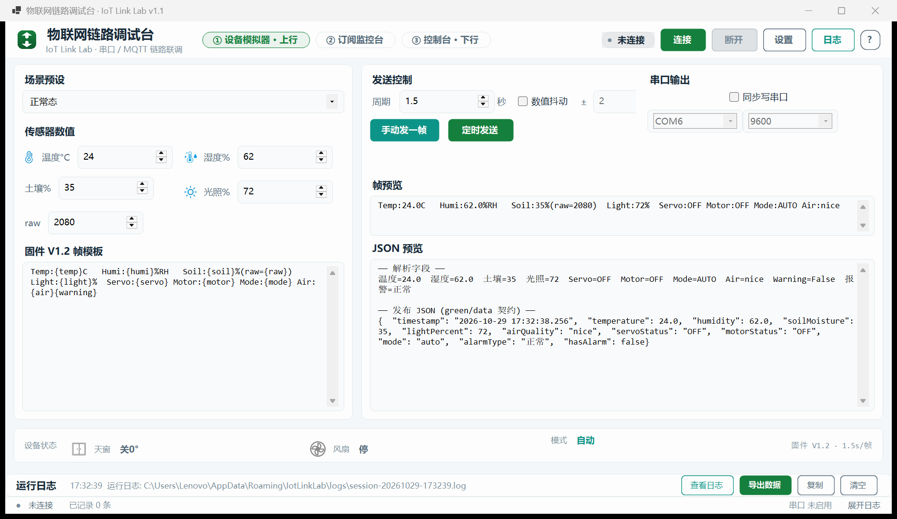
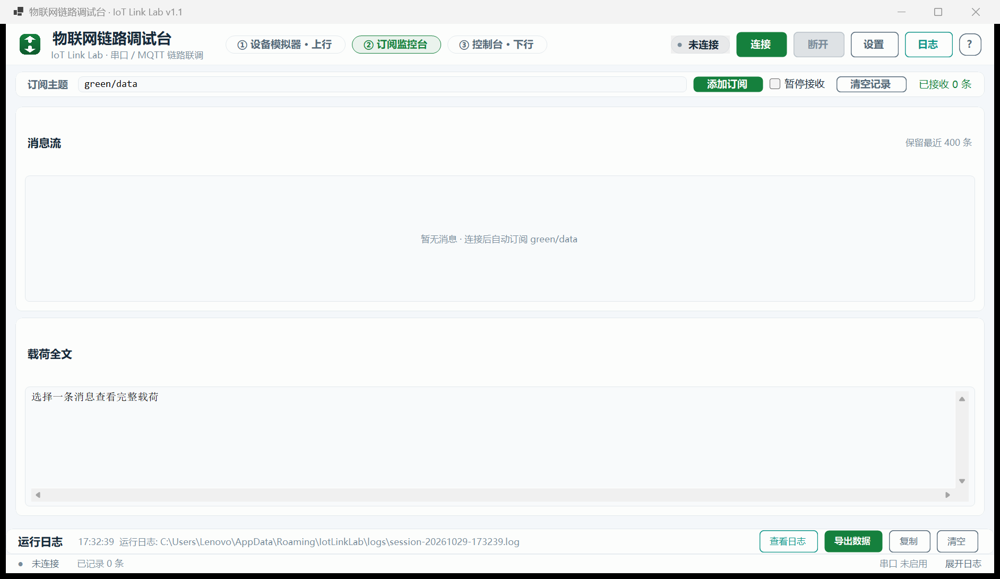
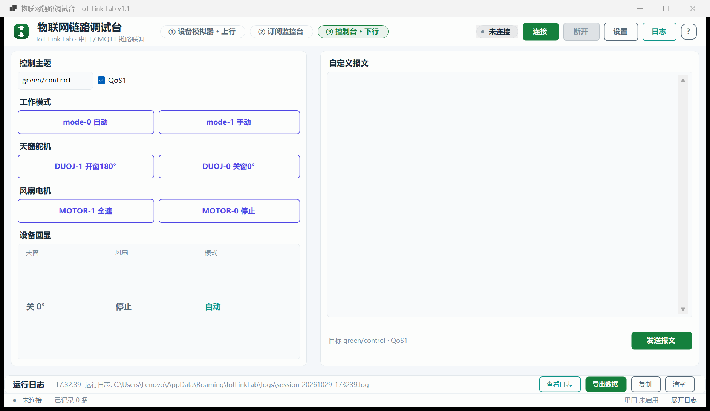
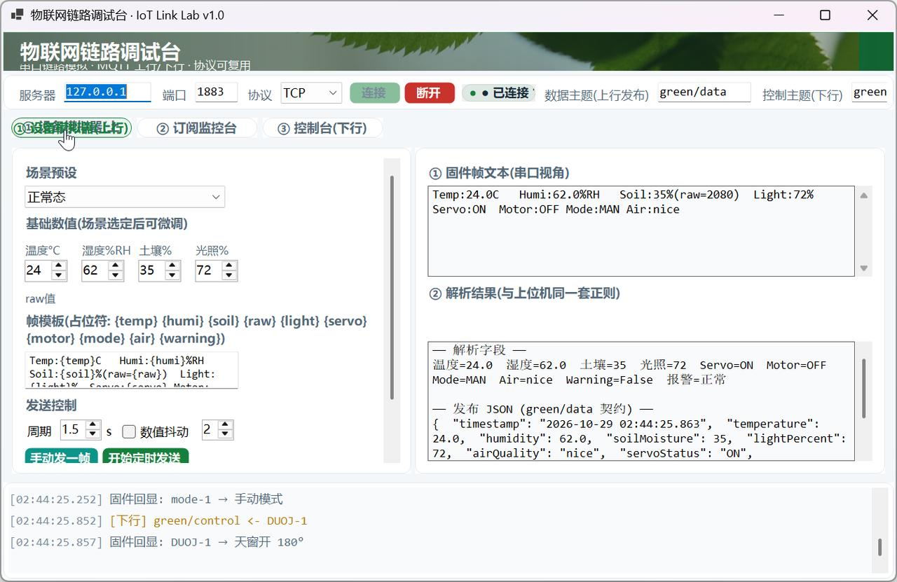
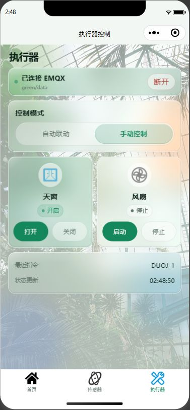
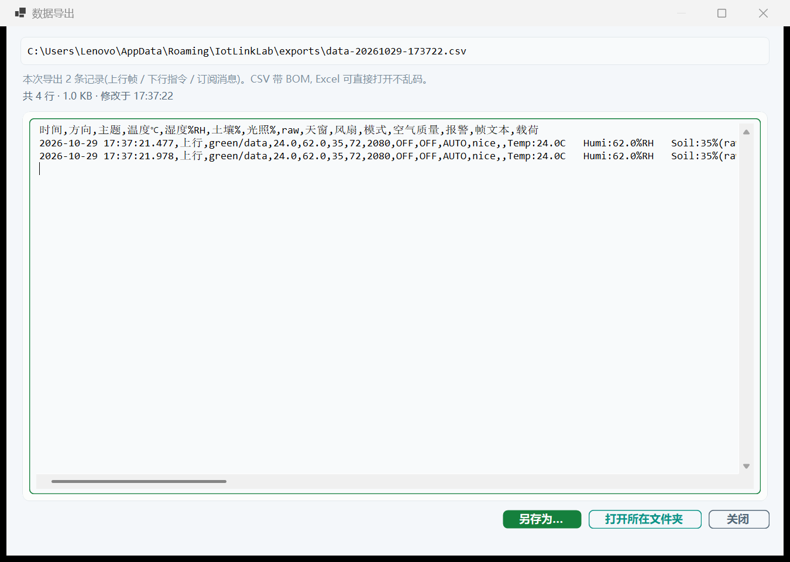
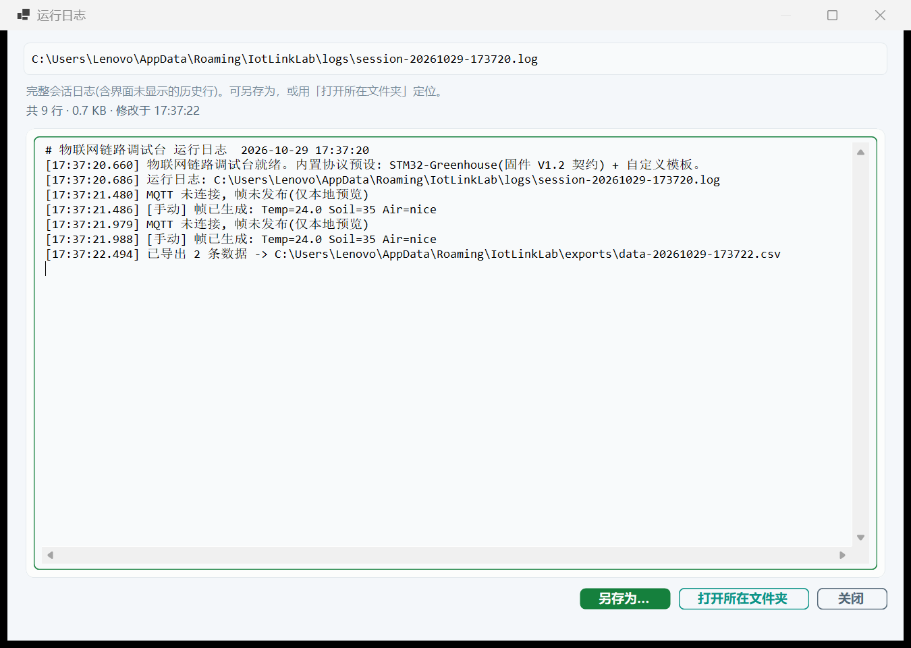

# 物联网链路调试台 · IoT Link Lab


**实物设备不在身边时的全链路联调工具**：在一台电脑上模拟"STM32 固件 → 串口 → 上位机 → EMQX"的上行数据流，
同时提供下行指令台与订阅监控台，打通 **上位机 / EMQX / 微信小程序** 三端的上下行通信验证。

> 设计为**通用组件**：协议层与 UI 解耦，内置 "STM32-Greenhouse" 预设，也可自定义帧模板复用到任何
> "串口设备 → 解析 → MQTT" 形态的项目。

## 界面截图

| ① 设备模拟器（上行） | ② 订阅监控台 | ③ 控制台（下行） |
| --- | --- | --- |
|  |  |  |

| E2E 闭环：小程序指令 → 固件模拟回显 → 帧回发 | 小程序端回显（天窗开启） |
| --- | --- |
|  |  |

**数据导出**

| 导出数据（`F8`）→ CSV | 查看日志（`F7`）→ 完整落盘日志 |
| --- | --- |
|  |  |

## 三页功能

### ① 设备模拟器（上行链路）

- **帧生成**：按固件协议模板渲染帧文本，占位符 `{temp} {humi} {soil} {raw} {light} {servo} {motor} {mode} {air} {warning}`
- **场景预设**：正常态 / 温度报警 / 湿度报警 / 土壤过湿 / 烟雾污染 / **DHT11 读取失败帧**（温湿度字段缺失，其余字段照常）
- **发送控制**：手动单发 / 定时轮发（周期可调，默认 1.5s 对齐固件）/ 可选数值抖动模拟真实波动
- **三层预览**：固件帧文本（串口视角）→ 解析字段（与上位机同一套正则）→ 发布 JSON（green/data 契约）
- **可选串口输出**：勾选后帧文本同步写入真实 COM（配合虚拟串口对 com0com，让**真实的智能温室.exe** 走完整"串口→解析→发布"链路）
- **固件模拟回显**：收到控制指令后自动更新模拟设备状态（开窗→下一帧 `Servo:ON`），底部"设备状态"条实时反映天窗/风扇/模式

### ② 订阅监控台

- 订阅任意主题（可添加多个），消息列表滚动保留最近 400 条 + 载荷详情 + JSON 查看
- 计数 / 速率统计 / 一键暂停；连接成功后自动订阅数据主题与控制主题

### ③ 控制台（下行链路）

- 固件指令集预设按钮：`mode-0/1`（任意时刻生效）、`DUOJ-0/1`、`MOTOR-0/1`（仅手动模式，与固件 `Parse_Command_Frame` 行为一致）
- 自定义报文原文透传；QoS0/QoS1 可选
- 下发后模拟器状态联动，日志同步显示"固件回显"或"固件忽略（自动模式）"

## 数据契约（内置 STM32-Greenhouse 预设）

与固件 `User/main.c`（V1.2）、上位机 `02-PC-UpperComputer/Form1.cs` 逐字段一致：

```
上行帧(1.5s/帧, \r\n 结尾, 9600 8N1):
Temp:24.0C   Humi:62.0%RH   Soil:35%(raw=2080)  Light:72%  Servo:OFF Motor:OFF Mode:AUTO Air:nice
报警时行尾追加 " Warning"；DHT11 失败帧无 Temp/Humi 段（"DHT11 Read Failed!   Soil:... "）

解析正则(与上位机一字不差): Temp:(-?\d+(?:\.\d+)?)C / Humi:(\d+(?:\.\d+)?)%RH /
Soil:(\d+)% / Light:(\d+)% / Servo:(ON|OFF) / Motor:(ON|OFF) / Mode:(AUTO|MAN) / Air:(nice|bad)

下行指令(green/control 原文透传): mode-0 / mode-1 / DUOJ-0 / DUOJ-1 / MOTOR-0 / MOTOR-1
```

发布 JSON（`green/data`，QoS1）与上位机 `PublishDataToMqtt` 完全同契约：

```json
{
  "timestamp": "2026-10-29 02:48:50.317",
  "temperature": 24.0,
  "humidity": 62.0,
  "soilMoisture": 35,
  "lightPercent": 72,
  "airQuality": "nice",
  "servoStatus": "OFF",
  "motorStatus": "OFF",
  "mode": "auto",
  "alarmType": "正常",
  "hasAlarm": false
}
```

统一报警阈值（三端一致）：温度>26°C / 湿度>85%RH / 土壤>40%（过湿）/ 空气 bad。

## 布局设计说明

界面按 **1256×728（96 DPI 逻辑像素）** 设计，运行时按实际 DPI 换算并收敛到屏幕可用区域；最小尺寸 **1080×640**：

- **顶部工作条 56px（紧凑 52px）**：应用标识 + 标题 + 三页签（模拟器 / 监控台 / 控制台）+ 连接状态徽章 + 连接/断开/设置/日志/快捷键帮助
  → **连接设置抽屉**（默认收起，展开 96px）：服务器、端口、协议、上行/下行主题
- **主区**：模拟器 40/60 双栏 + 底部设备状态条；监控台 订阅控制卡 + 消息流/载荷详情；控制台 42/58 指令区/报文编辑器
- **底部**：可折叠 **运行日志抽屉**（收起 34 / 紧凑 32；展开 168，可拖拽，状态持久化）
  → **全局状态栏 26px（紧凑 24px）**：MQTT 连接、已记录数据量、串口输出、日志开关
- **尺寸自适应**：下拉框/数字框/按钮宽度由 `UiFit` 用 GDI 文字度量实测；高度、边距、图标由 `UiFit.S()` 按 DPI 换算。
  `WebSocket` 不会被截成 `WebSocke`，`raw=4095` 也不会只剩 `208`。
- 设置抽屉与展开日志互斥，避免两者同时挤压主工作区；1256×728 下主区仍 ≥560px。
- 快捷键：`F1/F2/F3` 切页 / `F4` 立发一帧 / `F5` 连接 / `F6` 断开 / `F7` 查看日志 / `F8` 导出数据 / `F9` 连接设置 / `F10` 运行日志 / `F11` 最大化

> 详细视觉规范与验收口径见 [`UI-SPEC.md`](./UI-SPEC.md)（v3）。

## UI 规范 v3 使用说明

### 引入说明

- 自 **v3** 起，[`UI-SPEC.md`](./UI-SPEC.md) 是调试台 UI 的唯一事实来源；v2 的设计值
  （168px 顶部固定区、常驻连接卡、常驻日志）已废止。
- 规范覆盖：顶部工作条 + 三页签、连接设置抽屉、可折叠日志抽屉、全局状态栏、
  设计令牌（颜色/字号/圆角/间距）、`FieldShell` 输入体系、响应式断点与验收标准。
- 设计基准：**1256×728（96 DPI 逻辑像素）**，最小 **1080×640**；
  兼容 1280×720 逻辑分辨率（1920×1200 @150% DPI）。

### 使用方法

1. **改 UI 前先读规范**：打开 `UI-SPEC.md`，按第 3 节取设计令牌、第 4 节取控件规则。
2. **颜色/字号/圆角/高度只取 `Theme`**：不要新增散落颜色；字号只用
   `Theme.Title()/Section()/Body()/Meta()` 与 `Theme.Mono()`。
3. **尺寸只走 `UiFit`**：下拉框/数字框/按钮宽度用 `FitCombo/FitNumeric/SizeButton`；
   高度、边距、图标尺寸用 `UiFit.S()` 按 DPI 换算。
4. **输入控件必须用 `FieldShell`**：TextBox/ComboBox/NumericUpDown/ListView 不得使用
   `BorderStyle.FixedSingle`。
5. **改完必须三尺寸实拍**：1256×728、1080×640、最大化各截一张，检查无裁切、无重叠、
   关键按钮文案完整（`WebSocket`、`raw=4095`、`DUOJ-1 开窗180°`）。
6. **抽屉使用**：顶部「设置」或 `F9` 展开连接设置；顶部「日志」、状态栏「展开日志」或
   `F10` 展开运行日志；两者互斥。

### 注意事项

- `TableLayoutPanel` 设 `Dock=Fill` 且放在 `AutoSize` 行时，其默认首选高度是 **100px**，
  会把按钮/输入行裁成一条色带。控制区必须显式给定行高（模拟器右侧 148、控制台命令行 46）。
- `FieldShell` 使用透明背景 + 自绘圆角，不再设置 `Region`；内部控件左右保留 8px、
  上下保留 6px 内边距，否则圆角边框会被裁掉。
- 日志抽屉展开/收起状态写入 `%APPDATA%\IotLinkLab\settings.json` 的 `logOpen`、`logRatio`；
  旧版配置（无这两个字段）可直接读取。
- 150% DPI 下初始窗口为 1884×1092 物理像素（约 1241×691 逻辑客户区）；
  运行中跨显示器改变 DPI 需重启窗口，规范作为已知限制记录。

### 版本变更记录

| 版本 | 日期 | 主要变更 |
| --- | --- | --- |
| v1 | 2026-10-29 | 三页签调试台初版：横幅 + 连接卡 + 模拟器/监控台/控制台 + 数据导出 |
| v2 | 2026-10-29 | 修复下拉框/数字框裁字，收紧间距与日志区，补充 `UiFit` 实测宽度 |
| v3 | 2026-10-29 | 顶部工作条 + 可展开连接设置 + 可折叠日志抽屉 + 全局状态栏；`FieldShell` 圆角输入体系；DPI 尺寸换算；新增 `F9/F10` |

## 数据导出

界面日志框只保留最近 500 行，**完整记录始终落盘**，两者都从「运行日志」卡片一键查看：

| 按钮 | 行为 |
| --- | --- |
| 查看日志（`F7`） | 打开完整会话日志 `%APPDATA%\IotLinkLab\logs\session-*.log`，支持另存为、打开所在文件夹 |
| 导出数据（`F8`） | 把本次会话的上行帧 / 下行指令 / 订阅消息导出为 **CSV** → `%APPDATA%\IotLinkLab\exports\data-*.csv` |
| 复制 | 复制当前日志框内容到剪贴板 |
| 清空 | 只清界面日志框，不影响已落盘的日志文件 |

CSV 为 **UTF-8 带 BOM**（Excel 直接打开不乱码），列：`时间,方向,主题,温度℃,湿度%RH,土壤%,光照%,raw,天窗,风扇,模式,空气质量,报警,帧文本,载荷`。
订阅行也会被解析填列（JSON 载荷与原始串口帧文本两种格式都认），字段内的换行已压平，一条记录就是一行。


## 快速开始

`dotnet build`（.NET 10 SDK）或 Visual Studio 打开 `WinFormsApp1.slnx` 编译运行 `IotLinkLab.exe`。

**用法 A · 纯 MQTT 闭环（默认，零硬件）**

1. 启动 EMQX（见仓库根 README / `03-EMQX-Server`），工具填 `127.0.0.1:1883` 点「连接」
2. 设备模拟器选场景 → 「开始定时发送」——JSON 即持续发布到 `green/data`
3. 微信小程序（WebSocket `8083`）或任意 MQTT 客户端订阅 `green/data` 即可看到实时数据
4. 小程序「执行器」页下发指令 → 工具日志显示 `[下行]` 与固件回显，下一帧状态同步变化

**用法 B · 配合真实上位机（虚拟串口）**

1. 安装虚拟串口对工具（如 com0com）创建 COM 对（如 COM6↔COM7）
2. 工具勾选「同步写串口」选 COM6；真实上位机连接 COM7
3. 上位机走真实"串口接收 → 正则解析 → MQTT 发布"全链路，小程序照常订阅

**用法 C · 复用到其他项目**

帧模板可编辑（占位符替换），解析层自动适配；订阅监控台与控制台与协议无关，直接复用。

## 工程结构

```
├── WinFormsApp1.csproj   # net10.0-windows, MQTTnet 4.3.7 + System.IO.Ports
├── Program.cs            # 入口
├── Form1.cs              # 主窗体: 顶部工作条/连接设置抽屉/可折叠日志/全局状态栏/快捷键/设置持久化
├── Theme.cs              # 设计令牌(浅色科技风, 与上位机同一套温室绿语言)
├── Controls.cs           # RoundedButton / Card / StatusChip / NavChip / FieldShell 自绘控件
├── UiFit.cs              # 宽度按 GDI 实测文字; 高度/边距/图标按 DPI 换算(UiFit.S)
├── FrameCodec.cs         # 协议核心: 帧模板渲染 / 正则解析 / JSON 构建(可复用)
├── MqttLink.cs           # MQTT 服务: TCP/WS 双协议 + 指数退避重连
├── LogStore.cs           # 运行日志落盘: %APPDATA%\IotLinkLab\logs\session-*.log
├── DataStore.cs          # 数据记录与 CSV 导出: %APPDATA%\IotLinkLab\exports\data-*.csv
├── ExportDialog.cs       # 查看/另存/定位导出文件的通用对话框
├── SimulatorTab.cs       # ① 设备模拟器(含串口输出/固件回显)
├── MonitorTab.cs         # ② 订阅监控台
├── ControlTab.cs         # ③ 控制台
├── icon/                 # 应用图标源文件(7 档 ico + 各尺寸预览 + 生成/校验脚本)
└── assets/               # banner.jpg(历史横幅素材, 当前 UI 未使用) / app-mark.png / icons/
```

> 图标设计说明见 `icon/NOTES.md`：母题是"串口线上的一次信号跳变"，与 EMQX 启动器图标
> （青色对角渐变 + 弧形 WiFi + 纸飞机）在色相、轴向、笔画形态上三重区分。
> 自检脚本 `icon/verify_icon.py` 覆盖帧结构、AND mask、逐档尺寸与"不与 EMQX 图标同内容"共 101 项断言。


## 图片素材来源（Pexels 免费商用）

| 文件 | 内容 | 来源 |
| --- | --- | --- |
| `assets/banner.jpg` | 阳光下的绿叶 | [Pexels #4065601](https://www.pexels.com/photo/4065601/) |

## License

MIT
